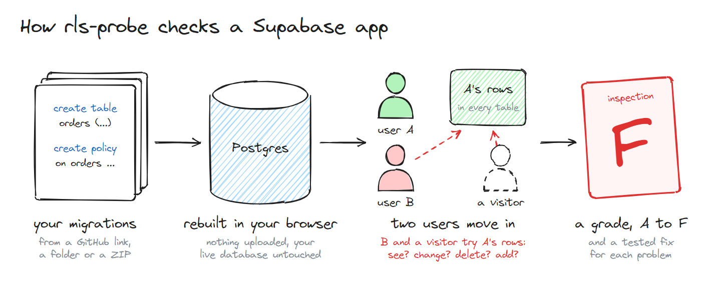
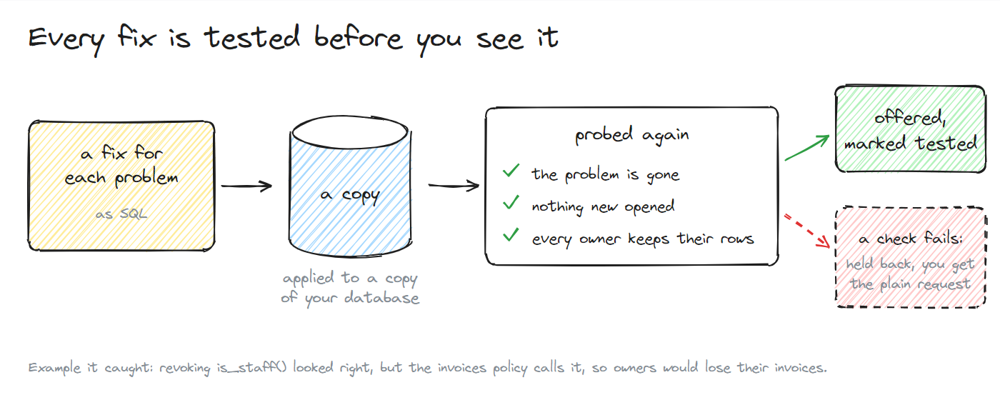
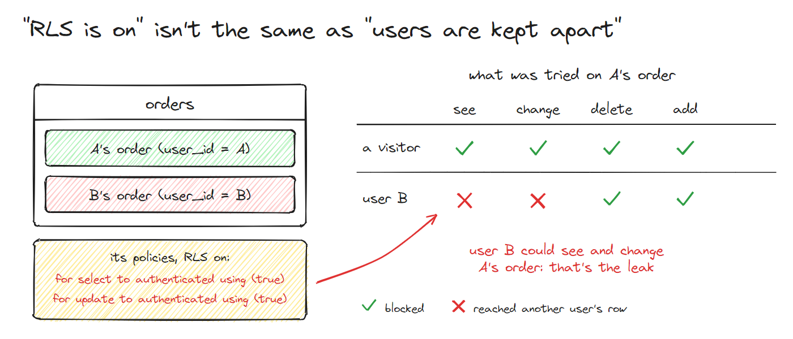
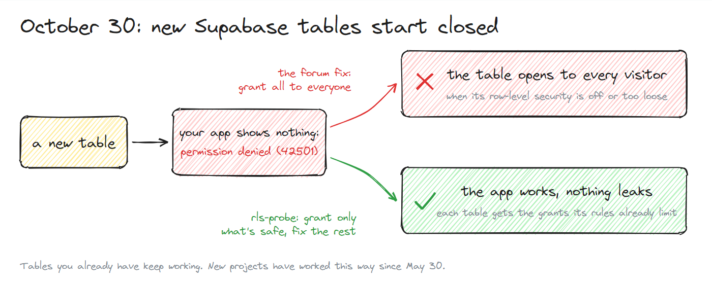

#  rls-probe

[](https://github.com/zkousama/rls-probe/actions/workflows/ci.yml)

Finds what a visitor, or another signed-in user, can read and change in a
Supabase app. It runs the app's migrations in an in-memory Postgres, signs in
two users who each own some rows, and tries every table as a visitor and as the
other user. Nothing touches a live database.

<picture>
  <source media="(prefers-color-scheme: dark)" srcset="site/public/diagrams/how-dark.png">
  
</picture>

```sh
npx rls-probe path/to/your-app
```

Or in your browser, with nothing to install: **[zkousama.github.io/rls-probe](https://zkousama.github.io/rls-probe/)**.
Paste a GitHub link, or drop the project folder or its ZIP. It runs on your computer, so
nothing is uploaded.

It reads `supabase/migrations/*.sql` (or `migrations/`, a folder of `.sql`
files, or one `.sql` file) and, when it's pointed at the app itself, scans the
code too. The report starts in plain words:

```
rls-probe: grade F. 6 problems to fix (5 tables checked).

  CRITICAL  Anyone on the internet can see, change, delete and add every row in the orders table.
  CRITICAL  Anyone on the internet can call the database function delete_order() to delete other users' orders: rls-probe tried it, and the test user's row in orders was deleted.
  CRITICAL  Your secret Supabase key (the service role key) is in your app's code at src/supabase.ts:3, so anyone can copy it and skip every rule.
  HIGH      Any signed-in user can change other users' messages.
  HIGH      Anyone on the internet can see your users' profiles, including email.
  HIGH      The edge function admin-export can be run by anyone on the internet.

Worth a look, and fine if it's on purpose:
  - Any signed-in user can see other users' messages.
  - The order_totals view shows its rows to anyone, skipping the rules on the tables underneath.
  - Files in the "invoices" storage bucket can be downloaded by anyone who has the link.
```

and goes on with the details: who could read, edit, delete or create rows in
each table, and why.

```
                         visitor (not signed in)     another signed-in user
table       RLS  rows    read  edit  delete  create  read  edit  delete  create
categories  on   shared  yes   -     -       -       yes   -     -       -
messages    on   users   -     -     -       -       yes   yes   -       -
notes       on   users   -     -     -       -       -     -     -       -
orders      OFF  users   yes   yes   yes     yes     yes   yes   yes     yes
profiles    on   users   yes   -     -       -       yes   -     -       -
```

## Fixing it with Lovable, Bolt, Cursor or Claude

```sh
npx rls-probe path/to/your-app --prompt
```

prints a request to paste into your AI builder. It names your own policies and
owner columns, so the builder changes the right thing, and adds SQL that already
passed a test:

```
4. Any signed-in user can change other users' messages.
   Change the policy "auth write" (using true) on "messages" so a user can only
   change rows where sender_id points to a profiles row whose id = auth.uid().
   Use that condition in both "using" and "with check".

   rls-probe tested this SQL on a copy of the database. It closes the problem, and
   afterwards each signed-in user can change only their own rows in messages.

   create policy "rls-probe: own messages only (update)" on public."messages" as restrictive
     for update to authenticated
     using ("sender_id" = (select auth.uid()))
     with check ("sender_id" = (select auth.uid()));
```

Run rls-probe again afterwards to check the fix.

### Fixes that are tested before you see them

<picture>
  <source media="(prefers-color-scheme: dark)" srcset="site/public/diagrams/fixes-dark.png">
  
</picture>

Each fix is applied to a copy of your database, which is then probed again. It's
offered only if its problem is gone, nothing new opened anywhere, and the owner of
every row (and their teammates, when the app has teams) can still do what they could
before. Each one says what changes afterwards, such as "each signed-in user sees only
their own rows in posts", so you can tell when it limits a feature.

```sh
npx rls-probe path/to/your-app --fix-policies
```

writes the fixes that passed as a new migration next to the others. Fixes for things
that may be on purpose are written commented out, and problems in the code (a leaked
key, an open edge function) are listed rather than fixed. A fix never rewrites your
policies: it revokes a grant or adds a restrictive policy, which narrows what the
existing ones allow. Run rls-probe again after applying it.

## In Claude Code, Cursor and other AI agents

So the agent checks its own migrations, and fixes and re-checks until nothing is
left. In Claude Code, install the plugin (a skill and the MCP server):

```text
/plugin install rls-probe --marketplace zkousama/rls-probe
```

On older versions: `/plugin marketplace add zkousama/rls-probe`, then
`/plugin install rls-probe@rls-probe`.

In Cursor, Windsurf, Claude Desktop or any other MCP client, add the server:

```json
{
  "mcpServers": {
    "rls-probe": { "command": "npx", "args": ["-y", "rls-probe@0.7.0", "mcp"] }
  }
}
```

It has three tools: `check_supabase_security` (the report, in plain words, with what
to change and the tested SQL), `write_supabase_security_fixes` (the `--fix-policies`
migration) and `write_supabase_grants_migration` (the `--fix` migration).

## Output

| Flag | Prints |
|---|---|
| (none) | The plain summary, then the details |
| `--prompt` | The request for an AI builder, with the tested SQL |
| `--markdown` | A Markdown report, for pull requests and AI agents |
| `--sarif` | SARIF, for GitHub code scanning |
| `--json` | Everything, for scripts |
| `--badge` | A README badge with the grade, linking to the web page |

`--markdown-file=<path>` and `--sarif-file=<path>` write those formats as well,
in the same run. `--test-fixes` adds the tested fixes to any format (`--prompt` and
`--fix-policies` always test them); it takes one more probe of the database, or a few
when a fix has to be tried on its own.

If some tables were made in the Supabase dashboard rather than in migrations,
check the live schema instead: `supabase db dump -f schema.sql`, then
`npx rls-probe schema.sql`. Only the schema is read, never your data.

Exits 1 when it finds something, so it can gate a build, and 2 when there was
nothing to check: no migrations, or no tables in them.

## Why

Apps built with Lovable, Bolt and other AI builders talk to Supabase straight
from the browser, with a key that ships to every visitor. Row-level security
decides which rows that key can reach. When a table has
it off, or a policy says `using (true)`, anyone can read other people's data, and
often change it. In 2025 a scan of 1,645 Lovable apps found 170 with exactly
that problem (CVE-2025-48757).

Reading policies by eye is slow and easy to get wrong: a policy can look right
and still let one user edit another's rows. So this doesn't read them. It tries.

<picture>
  <source media="(prefers-color-scheme: dark)" srcset="site/public/diagrams/reach-dark.png">
  
</picture>

## What it checks

- **Every table in `public`**, as a visitor with the public key and as a second
  signed-in user: can they read, edit, delete or create rows that belong to
  someone else? A row belongs to a user when a chain of foreign keys leads from
  it to `auth.users`. Tables with no such chain are "shared", like categories,
  and being readable by everyone is often what they're for.
- **Views**, which run with their owner's rights and skip the rules on the
  tables underneath unless they're `security_invoker`.
- **`security definer` functions** that visitors or any user can call. Each one is
  called as a visitor and as the second user, with arguments aimed at the first
  user's rows (their id, the id of their order), and what it did is compared:
  "rls-probe tried it, and the test user's row in orders was deleted". A function
  that only bumps a counter, or that checks `auth.uid()` and changes nothing, is
  marked as worth a look rather than as a problem.
- **Teammates**, when the app has groups (organization, team or workspace members):
  a third user joins the first user's group with the plainest role, and what they
  can see and change is shown, not graded, since sharing with teammates is usually
  the point. Fixes keep it working.
- **Storage**: every bucket the migrations create, and any a storage policy
  names (often made in the dashboard). Each user gets a file in their own folder,
  and a visitor and the other user try to see, replace, delete and upload into
  it. Public buckets are flagged too.
- **The code**: a service role key or `sb_secret_` key, or other secret keys, in
  front-end files or a build, `VITE_`/`NEXT_PUBLIC_` variables holding secrets,
  and edge functions with `verify_jwt = false` that don't check who's calling.

## Supabase's 2026 grants change

Supabase used to grant `anon`, `authenticated` and `service_role` every table
in `public`, and left row-level security to decide which rows. Projects created
since May 30, 2026 no longer get those grants for new tables, and from October
30, 2026 the same goes for new tables in every project. Tables that already exist keep
their grants. A table without one answers `permission denied` (42501).

The tempting fix for that error is a grant on every table. On a table with
row-level security off, or with a policy that's too loose, that grant is
what exposes the data.

<picture>
  <source media="(prefers-color-scheme: dark)" srcset="site/public/diagrams/trap-dark.png">
  
</picture>

```sh
npx rls-probe path/to/your-app --oct30
```

adds a section that rebuilds the database without the old grants and sorts
the tables:

```
Safe to grant: row-level security already limits these to the right rows.
  grant select on public.categories to anon, authenticated;
  grant select, insert, update, delete on public.notes to authenticated;

Your server too: edge functions and server code using the service role key get
42501 on these. The key skips row-level security and never reaches a browser, so
granting it is safe.
  grant select, insert, update, delete on public.categories to service_role;
  grant usage on sequence public.categories_id_seq to service_role;
  grant select, insert, update, delete on public.messages to service_role;
  grant select, insert, update, delete on public.notes to service_role;
  grant select, insert, update, delete on public.orders to service_role;
  grant select, insert, update, delete on public.profiles to service_role;

Fix before granting: a grant would open these up.
  messages: Users can change each other's data
  profiles: Visitors can read users' data

Closed only because nothing grants them: row-level security is off, so the quick
fix for 42501, a grant on every table, would expose every row.
  orders: enable row level security and add policies before granting anything.
```

The grants it suggests are the ones each table's policies need, including
`usage` on the sequence behind a `serial` id when users insert rows. The service
role loses its old grants too, so edge functions and server code need their own;
those are listed apart, for every table.
`--fix` writes them as a new migration next to the others, with the tables it
held back listed as comments, so the change is a file to read and commit.
`--grants=explicit` runs the whole probe as a project without the old grants.

## In CI

```yaml
- uses: zkousama/rls-probe@v0
  with:
    path: .            # the folder holding supabase/migrations
    args: --oct30      # the default
```

The report goes in the job summary, and the step fails when a table leaks or
needs a grant, so a migration that opens data never merges unnoticed.

To see the findings in the repository's Security tab and on pull request lines,
upload the SARIF file the step writes:

```yaml
permissions:
  security-events: write
steps:
  - uses: actions/checkout@v7
  - id: rls
    uses: zkousama/rls-probe@v0
  - if: always()
    uses: github/codeql-action/upload-sarif@v4
    with:
      sarif_file: ${{ steps.rls.outputs.sarif }}
```

## Does it match a real Supabase?

`scripts/compare-with-supabase.mjs` starts from a real local Supabase running the
same migrations, signs up two real users, repeats every check over the REST API
and compares. On the test app in `test/fixtures/leaky` all 38 checks agree.

`scripts/compare-grants-with-supabase.mjs` does the same for the grants change,
on a local Supabase opted in with the SQL from Supabase's changelog: every table
refuses before the suggested grants, and after them each user can create, read
and edit their own rows while a visitor and a second user reach nothing they
shouldn't. 30 of 30 checks pass on `test/fixtures/new-grants`.

`scripts/verify-oct30-on-supabase.mjs` does it for any app: it applies only the
grants marked safe, checks through the API that those tables answer and the
others still refuse, then runs the probe against the real database to show the
grants let nobody reach anything the rules didn't already allow, and that each
user can still do everything to their own rows that they could before. It also
checks the service role key: each table refuses it before the grants and answers
it after. On a 15-table open-source app built with Lovable, 100 of 100 checks
passed with 0.3.0.

The in-memory database has the parts of Supabase that access rules depend on:
the `anon`, `authenticated` and `service_role` roles, their default grants,
`auth.uid()`, `auth.jwt()`, `auth.users` and the storage tables. It also has
what migrations lean on without creating: `pgcrypto` and `uuid-ossp` in schema
`extensions` with Supabase's search path, the realtime publication and tables,
pg_cron's tables, and stand-ins for pgvector's types. Each migration file runs
in a fresh session, as Supabase runs it, so a pg_dump header's `search_path` or
`row_security = off` ends with its file. Statements run one at a time, so one
failure inside `BEGIN ... COMMIT` doesn't take the rest of the file with it.
Statements that only matter to a hosted project (comments, ownership changes,
vector indexes, extensions PGlite doesn't ship) are skipped and listed in the
report.

Tables the migrations use but never create, often made in the dashboard before
migrations were kept, are listed at the top of the report, since they can't be
checked.

On 25 open-source apps built with Lovable, Bolt or by hand (7 to 671 migration
files each), every run finishes, most in 2 to 4 seconds. Testing the fixes as well
(`--test-fixes`, `--prompt`, `--fix-policies`) takes 4 to 36 seconds, 8 for the median
app, and stops after three minutes on the largest (402 tables), leaving the fixes it
didn't get to marked untested. Of the 353 fixes proposed for the other 24 apps, 351
passed.

## Limits

- It seeds one row per user per table. A policy that depends on data the seed
  doesn't create, such as an `is_published` flag, may look stricter here than
  it is with real data.
- The other user is a stranger: no row in role or permission tables, and their
  own organization or team rather than A's. The teammate is found through a
  membership table named like `org_members`, `team_members` or `workspace_users`;
  an app that keeps members another way gets no teammate, and its fixes aren't
  checked against one.
- Functions are called once per caller, with arguments guessed from their names
  (`order_id` gets the id of the first user's order). A function that needs other
  arguments to do harm can look safer here than it is; the report says when a call
  changed nothing.
- A tested fix is tested against these users and these rows. Its "afterwards" line
  says what it takes away; read it before applying the fix.
- When a trigger fails while seeding, the row goes in without its triggers and
  the report says so. A create the probe couldn't test (a unique key, a
  trigger) is listed rather than counted as refused.
- Tables whose primary key is also the user's id, like `profiles`, can't be
  tested for "create a row for someone else": that row already exists.
- Storage is tested with files under a folder named for their owner, the way
  Supabase's examples store them. Rules built around other paths (a team's folder,
  say) may look stricter here than they are.
- By default it gives `anon`, `authenticated` and `service_role` every table in
  `public`, as Supabase projects have done. For a project created since May 30,
  2026, use `--grants=explicit`, or the report can show more than the API would
  let through.
- A finding is a place to look. Some tables are meant to be public; the report
  says so where it can't tell.

## Tests

```sh
npm test
```
